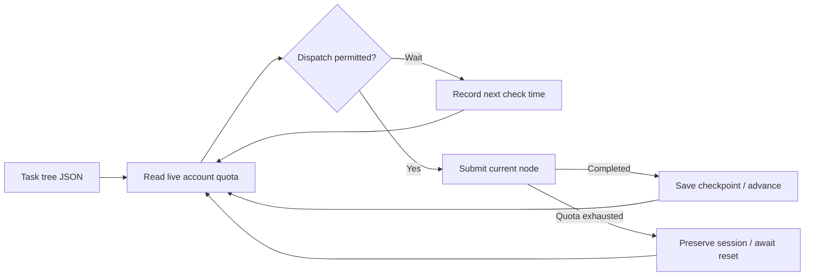

<div align="center">

# Codex Scheduler

Schedule Codex task trees using live account quota and configurable task prompts.


**English** · [简体中文](README_zh.md)

[Quick start](#quick-start) · [Scheduling policy](#scheduling-policy) · [Usage guide (Chinese)](docs/usage.md) · [ARC](https://github.com/Astonomy/arc)

</div>

## Overview

Scheduler submits task nodes to Codex in depth-first order, preserves execution checkpoints, and resumes quota-interrupted work in the original session. It operates independently or accepts requirement tasks generated by ARC.

| Capability | Behavior |
| --- | --- |
| Task trees | Execute parents before children, following child array order |
| Nighttime execution | Continue through the tree between 01:00 and 09:00 Beijing time, subject to quota |
| Daytime execution | Submit at most one node per five-hour window, within 30 minutes before reset |
| Quota recovery | Preserve the node and exact session ID; resume with `继续` when quota permits |
| Execution records | Retain per-node JSONL, stderr, exit codes, and checkpoints |



Quota is read through Codex app-server's `account/rateLimits/read` without starting a model turn. Unavailable quota data delays dispatch. After reset, Scheduler queries quota again before resuming.

## Quick start

Requirements: **Python 3.11+, Git, and an installed, authenticated Codex CLI**. Examples use Windows PowerShell.

Child Codex sessions run with full access, without sandboxing or approval prompts,
including resumed sessions. They inherit the scheduler process's OS permissions and credentials.

```powershell
git clone https://github.com/Astonomy/scheduler.git
cd scheduler
python -m venv .venv
./.venv/Scripts/python.exe -m pip install -e .
```

Create `config/task.json`. Set `workspace` to the absolute path of your target project and replace the example prompts with project-specific instructions.

```json
{
  "version": 1,
  "id": "my-project-001",
  "workspace": "D:/code/my-project",
  "tree": {
    "id": "core",
    "prompt": "Implement the agreed core functionality and run the relevant tests.",
    "children": [
      {"id": "api", "prompt": "Implement the agreed API using the core functionality and verify its behavior."},
      {"id": "regression", "prompt": "Run the project regression checks and resolve failures introduced by these changes."}
    ]
  }
}
```

Execution order: `core → api → regression`. Keep the task file and runtime state outside the target workspace.

```powershell
./.venv/Scripts/python.exe -m reqflow_scheduler quota config/task.json
./.venv/Scripts/python.exe -m reqflow_scheduler status config/task.json
./.venv/Scripts/python.exe -m reqflow_scheduler watch config/task.json
```

`watch` polls every 60 seconds by default and must remain running. Unattended execution requires a system service or task scheduler.

## Scheduling policy

All times use **Beijing time (UTC+8)**.

| Condition | Action |
| --- | --- |
| 01:00 inclusive to 09:00 exclusive | Continue depth-first execution while quota permits |
| Outside that period, within 30 minutes before the five-hour reset | Submit at most one node per window |
| Other daytime hours | Wait for the next eligible time |
| A relevant quota window is exhausted | Wait for the reported reset, then requery |
| Execution error, timeout, or manual stop | Preserve state; require inspection before recovery |

Weekly limits may delay recovery beyond five hours.

Set `"schedule_policy": "continuous"` in a task to dispatch at any hour and
continue through its tree while real quota permits. The default is `"windowed"`
and retains the daytime/nighttime rules above. This operational setting can be
changed without replacing execution checkpoints; quota reset waits, `not_before`,
stop handling and exact-session recovery still apply.

## Operations

### Task tree TUI and TOML policy

```powershell
# Live read-only tree, refreshed every 2 seconds (Ctrl+C exits).
./.venv/Scripts/Activate.ps1
scheduler view config/task.json
scheduler view config/task.json --once
scheduler view config/task.json --interval-seconds 5

# Validate/display policy, then apply it explicitly to execution.
./.venv/Scripts/python.exe -m reqflow_scheduler config --config config/scheduler.example.toml
./.venv/Scripts/python.exe -m reqflow_scheduler watch config/task.json --config config/scheduler.example.toml
```

`view` displays hierarchy, node status, current node (`>`), attempts, prompts and
next check time. It reads checkpoints without dispatching or querying quota.
Refresh is enabled by default; `--watch` remains supported and `--once` prints a
single snapshot. Redirected output emits successive snapshots. With an explicit
`--config`, the configured interval applies; `--interval-seconds` takes precedence.
The `scheduler` command is installed by `pip install -e .`; the existing
`reqflow-scheduler` and `python -m reqflow_scheduler` entrypoints also work.

[Example TOML](config/scheduler.example.toml) uses a `[scheduler]` table:
`schedule_policy` (`windowed` or `continuous`), `night_start_hour` and
`night_end_hour` (Beijing hours 0–23, start inclusive/end exclusive, overnight
ranges allowed), `reset_lead_minutes` (1–300), and `interval_seconds` (1–86400).
Explicit TOML settings, including defaults for omitted keys, override task policy;
CLI `--interval-seconds` overrides the TOML polling interval. No configuration file
is auto-loaded. Without `--config`, existing behavior remains. `config` alone
prints defaults. Configuration never bypasses quota or recovery checks.

```powershell
# Perform one scheduling pass; nighttime execution may advance multiple nodes.
./.venv/Scripts/python.exe -m reqflow_scheduler tick config/task.json

# Request termination of the running child at the next stop poll.
./.venv/Scripts/python.exe -m reqflow_scheduler stop config/task.json

# Confirm that the original child process has exited before recovery.
./.venv/Scripts/python.exe -m reqflow_scheduler recover config/task.json --inspected
./.venv/Scripts/python.exe -m reqflow_scheduler watch config/task.json
```

State defaults to `~/.reqflow-scheduler/<task-id>`; override it with `--state-dir`. Dispatched trees are immutable: use a new task ID for changed content. Use one OS/runtime per workspace.

A completed node indicates a successful Codex turn. Project tests and acceptance criteria determine whether the work is accepted.

## Documentation

- [Usage guide (Chinese)](docs/usage.md): optional settings, exit codes, Windows scheduling, and compatibility.
- [Example task](config/task.example.json) · [Codex skill](skills/scheduler/SKILL.md) · [Plugin manifest](plugin.json).
- [ARC](https://github.com/Astonomy/arc): compile clarified requirements into TDD tasks for Scheduler.
- [Historical design (Chinese)](PLAN.md): retained for reference; current behavior follows the code and current documentation.

Run the test suite:

```powershell
./.venv/Scripts/python.exe -m unittest discover -s tests -v
```

Tests use simulated quota and execution; they do not consume live Codex quota.
