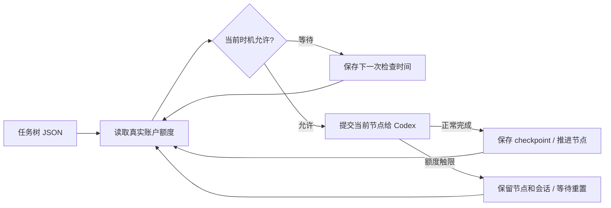

<div align="center">

# Codex Scheduler

### 你安排任务，Scheduler 守住执行时机。

把开发工作排成任务树，按真实账户额度和北京时间自动提交给 Codex。夜间逐步推进，触限后保留会话，额度恢复后接着做。


[快速开始](#快速开始) · [调度规则](#什么时候执行) · [完整手册](docs/usage.md) · [搭配 ARC](https://github.com/Astonomy/arc)

</div>

---

## 把“下一步做什么”提前排好

多阶段开发经常被额度重置和手动续跑打断。Scheduler 保存任务顺序、提交时机和会话，让一棵任务树可以跨窗口继续推进。

| 你的安排 | Scheduler 的处理 |
| --- | --- |
| 先实现核心，再补接口和测试 | 父节点完成后，按子节点顺序深度优先执行 |
| 希望夜间集中推进 | 北京时间 01:00–09:00，在额度允许时连续执行 |
| 白天利用即将重置的窗口 | 五小时窗口重置前 30 分钟，最多提交当前节点一次 |
| 执行中遇到额度限制 | 保存精确会话 ID，等待实际额度恢复，在原会话发送“继续” |
| 想知道停在哪里 | `status` 查看 checkpoint；每个节点保留运行日志 |



额度通过 Codex app-server 的 `account/rateLimits/read` 获取，查询本身不启动模型 turn。无法读取时等待重试；重置后重新查询，不假定额度已经恢复。

## 快速开始

需要 **Python 3.11+、Git，以及已安装并登录的 Codex CLI**。下面以 Windows PowerShell 为例。

```powershell
git clone https://github.com/Astonomy/scheduler.git
cd scheduler
python -m venv .venv
./.venv/Scripts/python.exe -m pip install -e .
```

在仓库的 `config/task.json` 中写下任务，把 `workspace` 改成真实开发项目的绝对路径：

```json
{
  "version": 1,
  "id": "my-project-001",
  "workspace": "D:/code/my-project",
  "tree": {
    "id": "core",
    "prompt": "实现项目中已明确的核心功能，并运行相关测试。",
    "children": [
      {"id": "api", "prompt": "基于核心功能实现已约定的接口，并验证行为。"},
      {"id": "regression", "prompt": "运行项目回归检查，修复本次改动引入的问题。"}
    ]
  }
}
```

执行顺序为 `core → api → regression`。提示词只是示例，提交前请替换成自己的明确任务。任务文件与状态放在目标 workspace 外；以上布局适用于另一个项目作为 workspace。

```powershell
# 查看真实额度和当前进度
./.venv/Scripts/python.exe -m reqflow_scheduler quota config/task.json
./.venv/Scripts/python.exe -m reqflow_scheduler status config/task.json

# 开始等待调度，默认每 60 秒轮询
./.venv/Scripts/python.exe -m reqflow_scheduler watch config/task.json
```

`watch` 需要保持进程运行。只有任务文件时不会自动执行；无人登录时运行需另行配置系统服务或任务计划程序。

## 什么时候执行？

默认时区为 **北京时间 UTC+8**。

| 时间 / 状态 | 行为 |
| --- | --- |
| 01:00（含）–09:00（不含） | 从当前节点继续，额度允许时按深度优先顺序连续推进 |
| 其他时间，且距五小时窗口重置 ≤30 分钟 | 当前窗口最多提交一个节点 |
| 其他白天时刻 | 等待下一次允许时机 |
| 任一相关额度窗口耗尽 | 等待服务端重置时间，重新查询后决定是否恢复 |
| 普通错误、超时或主动停止 | 保留状态；检查原进程后显式恢复 |

周额度耗尽时，等待可能超过五小时。窗口信息来自实际账户；后续何时耗尽无法提前预测。

## 随时查看、停止和恢复

```powershell
# 单次检查；夜间也可能在此调用中推进多个节点
./.venv/Scripts/python.exe -m reqflow_scheduler tick config/task.json

# 请求停止：运行中的子进程在下一次停止轮询时被终止
./.venv/Scripts/python.exe -m reqflow_scheduler stop config/task.json

# 先确认原子进程已退出，再恢复 checkpoint
./.venv/Scripts/python.exe -m reqflow_scheduler recover config/task.json --inspected
./.venv/Scripts/python.exe -m reqflow_scheduler watch config/task.json
```

默认状态目录：`~/.reqflow-scheduler/<任务ID>`。用 `--state-dir` 自定义位置；每个节点保留会话 ID、JSONL、stderr 和退出码。

- 已派发的任务树内容固定，修改内容请使用新任务 ID。
- 同一任务和工作区使用操作系统锁互斥；同一 workspace 使用同一种 OS/runtime。
- 节点完成表示 Codex 正常结束 turn，业务验收仍应由项目自己的测试和验收流程确认。

## 从需求到夜间执行

[ARC](https://github.com/Astonomy/arc) 可先把自然语言要求澄清为带测试计划的原子 REQ，再导出 Scheduler 任务树。也可以直接手写 JSON，Scheduler 可独立用于任意项目。

## 文档与开发

- [完整使用手册](docs/usage.md)：可选配置、退出码、Windows 任务计划与兼容行为。
- [任务样例](config/task.example.json) · [Codex skill](skills/scheduler/SKILL.md) · [插件清单](plugin.json)。
- [历史设计](PLAN.md)：用于追溯，当前行为以本 README 和代码为准。

```powershell
./.venv/Scripts/python.exe -m unittest discover -s tests -v
```

测试使用模拟额度与执行器验证调度行为，不需要消耗真实 Codex 额度。
