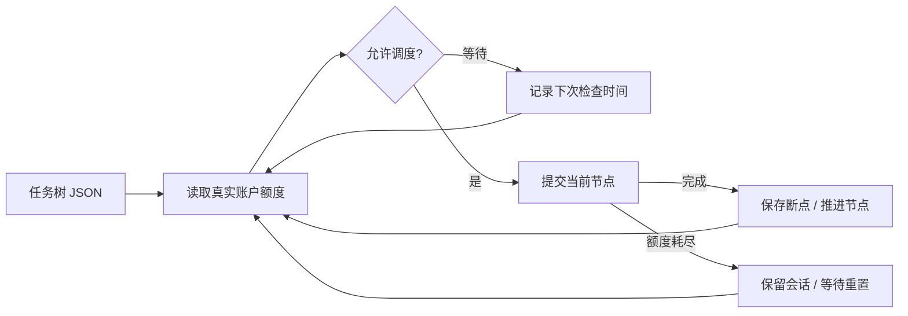

<div align="center">

# Codex Scheduler

基于真实账户额度和任务树的 Codex 定时调度工具。


[English](README.md) · **简体中文**

[快速开始](#快速开始) · [调度规则](#调度规则) · [完整手册](docs/usage.md) · [ARC](https://github.com/Astonomy/arc)

</div>

## 概述

Scheduler 从根节点逐层向 Codex 提交任务，同层节点并行，本层全部完成后进入下一层，子节点数量不设上限，保存执行断点，并在额度恢复后继续原会话。可独立使用，也可接收 ARC 生成的需求任务。

| 功能 | 行为 |
| --- | --- |
| 任务树 | 父节点完成后，按子节点数组顺序执行 |
| 夜间执行 | 北京时间 01:00–09:00，在额度允许时连续推进 |
| 白天执行 | 五小时额度窗口重置前 30 分钟，每个窗口最多提交一层节点 |
| 额度恢复 | 保留当前节点和精确会话 ID，额度允许后发送“继续” |
| 执行记录 | 保存各节点的 JSONL、stderr、退出码和断点 |



额度通过 Codex app-server 的 `account/rateLimits/read` 读取，查询不启动模型 turn。无法读取时延后调度；重置后重新查询，再决定是否恢复。

## 快速开始

需要 **Python 3.11+、Git，以及已安装并登录的 Codex CLI**。以下使用 Windows PowerShell。

```powershell
git clone https://github.com/Astonomy/scheduler.git
cd scheduler
python -m venv .venv
./.venv/Scripts/python.exe -m pip install -e .
```

创建 `config/task.json`，将 `workspace` 改为目标项目绝对路径，并替换示例提示词。

```json
{
  "version": 1,
  "id": "my-project-001",
  "workspace": "D:/code/my-project",
  "tree": {
    "id": "core",
    "prompt": "实现已约定的核心功能，并运行相关测试。",
    "children": [
      {"id": "api", "prompt": "基于核心功能实现已约定的接口，并验证行为。"},
      {"id": "regression", "prompt": "运行项目回归检查，修复本次改动引入的问题。"}
    ]
  }
}
```

执行顺序为 `core → api → regression`。任务文件和运行状态应放在目标 workspace 外。

```powershell
./.venv/Scripts/python.exe -m reqflow_scheduler quota config/task.json
./.venv/Scripts/python.exe -m reqflow_scheduler status config/task.json
./.venv/Scripts/python.exe -m reqflow_scheduler watch config/task.json
```

`watch` 默认每 60 秒轮询，需保持进程运行。无人值守运行需配置系统服务或任务计划程序。

## 调度规则

时间均为 **北京时间 UTC+8**。

| 条件 | 行为 |
| --- | --- |
| 01:00（含）至 09:00（不含） | 在额度允许时逐层执行，同层节点并行 |
| 其他时段，距五小时窗口重置不超过 30 分钟 | 每个窗口最多提交一层节点 |
| 其他白天时刻 | 等待下一次允许时机 |
| 相关额度窗口耗尽 | 等待服务端重置时间，再查询额度 |
| 执行错误、超时或主动停止 | 保留状态，检查原进程后显式恢复 |

周额度限制可能使等待时间超过五小时。

## 运行管理

```powershell
# 单次调度检查；夜间可能推进多个节点
./.venv/Scripts/python.exe -m reqflow_scheduler tick config/task.json

# 请求停止，运行中的子进程在下一次停止轮询时终止
./.venv/Scripts/python.exe -m reqflow_scheduler stop config/task.json

# 确认原子进程已退出后恢复
./.venv/Scripts/python.exe -m reqflow_scheduler recover config/task.json --inspected
./.venv/Scripts/python.exe -m reqflow_scheduler watch config/task.json
```

默认状态目录为 `~/.reqflow-scheduler/<任务ID>`，可用 `--state-dir` 修改。已派发的任务树不可修改，变更内容需使用新任务 ID。同一 workspace 使用同一种 OS/runtime。

节点完成表示 Codex turn 正常结束，业务验收以项目测试和验收标准为准。

## 文档

- [完整手册](docs/usage.md)：可选配置、退出码、Windows 调度和兼容行为。
- [任务样例](config/task.example.json) · [Codex skill](skills/scheduler/SKILL.md) · [插件清单](plugin.json)。
- [ARC](https://github.com/Astonomy/arc)：将澄清后的需求编译为可调度的 TDD 任务。
- [历史设计](PLAN.md)：保留用于追溯，当前行为以代码和现行文档为准。

运行测试：

```powershell
./.venv/Scripts/python.exe -m unittest discover -s tests -v
```

测试使用模拟额度和执行器，不消耗真实 Codex 额度。


## 任务树 TUI 与 TOML 配置

在任意目录使用命令，无需激活虚拟环境（全局安装一次即可）：

```powershell
uv tool install --editable D:/code/scheduler
uv tool update-shell
# 更新 PATH 后重新打开终端
scheduler list
scheduler view D:/code/scheduler/config/你的任务.json
```

`scheduler list` 合并列出安装目录 `config` 下的任务文件和用户目录
`.reqflow-scheduler` 下的运行记录，显示状态、已完成/总节点数、当前节点及绝对路径，
排除示例任务。其他目录使用 `--task-dir D:/tasks`、`--state-dir D:/scheduler-state` 指定。
只有运行记录、找不到定义的任务也会列出；列表不会执行任务或查询额度。
`view` 支持任务 ID 或文件路径，例如 `scheduler view reqcomp-cycle-20261031-retry-001`。
任务 ID 按安装目录 `config` 中 JSON 的 `id` 字段查找，可用 `--task-dir D:/tasks` 改变查找目录；
重复 ID 需使用明确的文件路径。只有状态记录、没有任务定义时无法重建任务树。
若执行时自定义了 `--state-dir`，查看时也需传入相同目录。

```powershell
# 激活虚拟环境后查看实时任务树，Ctrl+C 退出
./.venv/Scripts/Activate.ps1
scheduler view config/task.json
scheduler view config/task.json --once
# 校验并输出配置（省略 --config 则输出默认值）
./.venv/Scripts/python.exe -m reqflow_scheduler config --config config/scheduler.example.toml
# 使用配置执行调度
./.venv/Scripts/python.exe -m reqflow_scheduler watch config/task.json --config config/scheduler.example.toml
```

`view` 展示全部节点及下次检查时间；节点后以 `✓` 表示完成、`-` 表示未完成、转圈动效表示执行中，不展示提示词和任务输出，只读取检查点，不执行任务或查询额度。

安装或更新后可直接运行 `scheduler view 任务文件.json`，默认每 2 秒刷新，Ctrl+C 退出。
`--once` 只显示一次；`--watch` 仍兼容。显式传入 `--config` 时使用配置间隔，
`--interval-seconds` 优先。原有 `python -m reqflow_scheduler` 入口仍可使用。

子任务首次执行及恢复会话均使用 full access，关闭沙箱和审批提示，继承 scheduler 进程的系统权限及凭据。

示例文件：[scheduler.example.toml](config/scheduler.example.toml)。`[scheduler]` 支持：

- `schedule_policy`：`windowed`（默认）或 `continuous`（全天按额度连续执行）。
- `night_start_hour` / `night_end_hour`：北京时间 0–23，起点包含、终点不包含，允许跨午夜，不能相同。默认 1–9。
- `reset_lead_minutes`：日间重置前可提交窗口，1–300 分钟，默认 30。
- `interval_seconds`：轮询间隔，1–86400 秒；配置默认 60 秒，未传配置的 `view` 默认 2 秒。

仅显式传入 `--config` 时加载 TOML，配置及其缺省值覆盖任务中的策略；命令行 `--interval-seconds` 优先于 TOML。未传配置保持原有行为。配置不会跳过额度和恢复检查。skill 支持 `view`、`config` 及这些调用选项。
