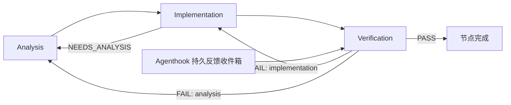

# 分阶段多模型调度（配置版本 1）

## 原有架构与扩展位置

Scheduler 是无第三方运行依赖的 Python 包。`scheduler.py` 读取版本 1 JSON 任务树，按广度逐层派发，同层并行；节点的 `attempts`、精确 `session_id`、PID 和状态保存在工作区之外。`dispatch.py` 用无 shell 的 argv 和 stdin 启动 `codex exec --json`，并解析 JSONL。Windows 的 npm/Volta shim 会解析到 Node 入口。`quota_adapter.py` 经 Codex app-server 的 `account/rateLimits/read` 读取真实额度，不启动模型 turn。原有北京时间时段、白天重置窗口、停止、恢复、工作区锁和追加树规则继续使用。

旧节点以 Codex turn 成功退出作为完成条件。外置 `D:/code/481/agenthook` 原来读取 ArcBench 的运行、测试、网页和日志，生成新的优化任务树并调用 Scheduler `submit`；未指定新配置时仍采用这一行为。`archive/` 中的历史数据没有迁移。

新增 `routing.py` 集中校验阶段路由并适配 Codex 参数；`stages.py` 负责输出契约、上下文交接、状态迁移、预算、统计与反馈收件箱。`scheduler.py` 继续拥有派发权，`dispatch.py` 继续通过 Codex 执行，Agenthook 不选择模型，也不调用模型 API。路由按阶段名称查找，可以增添模型和命名路由；当前内置执行协议为以下三个阶段。



每个启用 orchestration 的节点都有完整三阶段流程。同层仍可并行，每次阶段派发前重新检查原有时间和额度策略；白天仍每窗口最多派发一批。设置 Token 预算时，同层阶段串行，以便后续调用使用最新用量。子层仅在上一层各节点 Verification PASS 后启动。

## 模型与当前环境核验

2026-11-11 在本机检查了 CLI 0.166.0 的 `exec --help`、`exec resume --help` 和无需模型 turn 的 app-server `model/list`：

| 阶段 | Codex 模型 ID | Provider/Profile | 推理配置 |
| --- | --- | --- | --- |
| Analysis | `gpt-6-astra` | `model_provider=openai` | 显式 `high`，目录确认支持 |
| Implementation | `deepseek-flash` | 继承 `deepseek.config.toml` 的 `deepseek` Provider | 不传新的 effort 参数，继承现有 profile |
| Verification | `gpt-6.1-sol` | `model_provider=openai` | 显式 `medium`，目录确认支持 |

本机 `--profile deepseek` 的含义是叠加 `$CODEX_HOME/deepseek.config.toml`，不是旧版 `[profiles.deepseek]` 表。本实现针对实际验证的文件式 profile，不猜测旧版 CLI 的兼容行为。模型、Provider、effort 通过 Codex CLI 参数覆盖；不会写全局配置或管理 API key。

**实际阻塞：** 当前 DeepSeek Provider 的 `env_key` 不符合环境变量名称格式，且进程没有对应变量。预检会明确报告 credential 配置缺失/错误，并在 Analysis 首次派发之前阻止付费调用。需要在原有 Codex 配置中修复这个问题。`env_key` 应指定存放凭证的环境变量名称；Scheduler 不会修复或复制凭证。`deepseek-flash` 是现有 profile 的配置 ID；由于该阻塞，尚未验证其远端是否确实映射到 DeepSeek V4 Flash，也未验证远端结构化输出能力。

OpenAI 路由必须在当前 Codex 目录中存在且支持所选 effort。第三方路由复用已有 profile 的模型和 Provider，并检查其声明的凭证环境变量；没有另建第三方 `/models` 或生成 API。目录和本地配置预检不等同于远端生成成功。远端模型拒绝或认证失败会保存错误并中断，不会自动换模型。参考 [Codex 配置文档](https://learn.chatgpt.com/docs/config-file/config-reference)。

## 配置和 Windows 使用

配置样例为 `config/stage-routing.example.toml`，集中声明三个模型。`config/stage-task.example.json` 展示任务如何通过 `routing_config` 引用它。该路径相对任务文件，仅读取模型路由，不覆盖调度时段。也可使用 `--config FILE.toml` 一并传入 `[scheduler]` 和 `[model_routing]`。

任务必须显式包含 `orchestration` 对象才启用阶段流程：

```json
"orchestration": {
  "version": 1,
  "max_calls": 18,
  "max_cycles": 3,
  "max_stage_attempts": 2
}
```

- `max_calls`：整棵任务树的 Codex 调用尝试总上限，重试和恢复都计入。并行派发前预留次数，避免兄弟节点超额。
- `max_cycles`：每节点失败回退次数上限；另限制每节点接收的不同反馈数量。预算不会因新反馈或进程重启重置。
- `max_stage_attempts`：同一阶段连续非法输出的最大尝试次数。进程错误、超时、停止继续保留原有人工检查/恢复机制，总调用预算仍生效。
- 可选 `max_tokens`：后续调用的门槛。已报告 Token 达到上限或有调用用量未知时，阻止后续调用。它不能预先约束单次 Codex turn 的实际消耗，因此不是金额或单次 Token 的硬上限。

先复制样例，设置唯一任务 ID、真实工作区、需求和验收标准，再执行：

```powershell
cd D:/code/scheduler
# 只做配置/模型目录预检，不启动模型 turn；当前 DeepSeek 问题会使其退出 2
.venv/Scripts/python.exe -m reqflow_scheduler models config/my-stage-task.json
# 预检问题修复后，沿用正常时段和额度策略运行
.venv/Scripts/python.exe -m reqflow_scheduler watch config/my-stage-task.json
.venv/Scripts/python.exe -m reqflow_scheduler status config/my-stage-task.json
.venv/Scripts/python.exe -m reqflow_scheduler usage config/my-stage-task.json
.venv/Scripts/python.exe -m reqflow_scheduler view config/my-stage-task.json --once
```

停止/恢复仍使用 `stop`、`continue` 或检查进程后的 `recover --inspected`。中断阶段恢复精确会话，发送“继续”；正常阶段切换始终新建会话，Verification 不复用 Implementation 会话。阶段任务不接受节点预设的 `session_id`。已派发任务的模型路由和预算纳入原有执行指纹，修改时需使用新任务 ID；旧任务指纹算法保持兼容。中断会话的 Provider/profile/模型/effort 若变化，会拒绝续跑。

## 输出、交接与独立检查

每次调用提供 `--output-schema`，同时在 Scheduler 内再次校验，不能仅依赖远端结构化输出支持。字段类型均为字符串数组，枚举除外：

| 阶段 | 必填字段 |
| --- | --- |
| Analysis | `requirements`, `architecture`, `implementation_plan`, `affected_files`, `dependencies`, `risks`, `test_plan` |
| Implementation | `status`（`IMPLEMENTED`/`NEEDS_ANALYSIS`）, `changes`, `tests`, `logs`, `issues` |
| Verification | `status`（`PASS`/`FAIL`）, `requirement_coverage`, `correctness`, `test_results`, `identified_issues`, `suggested_fixes`, `rework_stage`（`analysis`/`implementation`） |

原始需求、Analysis 结果、实现结果、上次审查、实际命令日志和 Agenthook 证据进入后续提示词。Verification 另接收实际 `git diff HEAD` 和含未跟踪文件的 `git status`，并要求独立查看文件、重跑测试。仓库读取失败会如实保留退出码和错误。PASS 必须具有覆盖、正确性和测试说明，不得有未解决问题，且本次验证会话至少执行过一次退出码为 0 的工具命令；这只是最低证据门槛，测试是否充分仍由独立模型按原验收标准判断。没有用退出码代替业务验收。

状态目录中每次调用保留 `output-schema.json`、`events.jsonl`、`stderr.log` 和合法输出的 `result.json`。`state.json` 另保存 `results`、`artifacts` 和调用账本。模型 turn 完成先保存为 `turn_completed`，只有阶段交接成功后才推进状态；若此时崩溃，重启或 continue 会处理已保存结果，不重复启动该模型，也不会把 Analysis 的成功当成整个节点成功。

## Agenthook 集成

Scheduler 支持两种输入，都保持原任务 ID，模型完全由路由配置决定：

```powershell
# 读取本机现有 Agenthook 完成文件及其相邻原始证据
.venv/Scripts/python.exe -m reqflow_scheduler feedback config/my-stage-task.json `
  --completion D:/code/481/agenthook/artifacts/RUN_ID/completion.json --node feature
# 其他外置组件可以提交版本 1 事件
.venv/Scripts/python.exe -m reqflow_scheduler feedback config/my-stage-task.json --event D:/tasks/feedback.json
.venv/Scripts/python.exe -m reqflow_scheduler submit config/my-stage-task.json
```

事件需要 `version=1`、`task_id`、`node_id`、唯一 `event_id`、`test_results`、`logs` 和 `context`。原生 Agenthook 适配器读取 `completion.json`、`analysis.json`、`logs.json`、`run.json`，交叉校验 run ID，并保留原始 requirement/task ID、网页上下文、分数、完整日志和证据路径。完成信号不直接使任务成功，而是进入 Verification。

反馈先持久化到独立加锁的 `feedback-inbox.json`。Scheduler 正在运行时也可接收；阶段边界才修改节点。停止/中断的任务仍需原有恢复操作。收件箱先保存状态再移除事件，崩溃后的重放幂等。相同事件只处理一次；同 ID 的不同证据会报错，相同有效载荷不触发重复检查；数量、回退次数和调用预算共同限制循环。反馈 CLI 返回 queued 只表示证据已保存，不表示已开始或通过验证。

本机外置 Agenthook 的 `workflow.py`、`hook.py` 已增加可选关联。其用户配置可加入：

```json
"scheduler_task": "D:/tasks/my-stage-task.json",
"scheduler_node": "feature",
"scheduler_config": "D:/tasks/scheduler.toml",
"scheduler_state_dir": "D:/scheduler-state"
```

后三项可省略。关联后 hook 对通过和失败结果都先调用 `feedback --completion`，成功后 `submit` 原任务，并复用原来的派发回执；不再生成一棵新的优化树。未关联时维持旧流程。没有替用户关联任何现有任务、上传 ArcBench run 或启动 watcher。

外置目录不属于当前 Git 仓库，交付另包含 `integrations/agenthook-stage-feedback.patch`，保存这三个外置文件的源码/测试改动，以便其他安装副本复用；本机已经应用，无需重复应用。

## 用量、验证结果和边界

每次账本记录 task/node/stage、所选模型、Codex Provider、实际模型 Provider、profile、显式和继承的 effort、会话、耗时、Token 原始数据、日志目录和结果。`usage` 按整任务、节点、模型、阶段和 Provider 汇总。

`model` 表示传给 Codex 的确定模型 ID；`actual_model` 仅在事件报告时填写，否则为 `null`。`calls` 表示保守计数的 Codex 启动尝试，启动前已预留；Codex 内部多轮 API 调用次数没有公开数据时 `api_calls=null`。缺失 Token 为 `null`，汇总保留 `known_tokens` 和 `unknown_usage_calls`，不会把部分数据冒充总量。未知耗时同样单独标记。

验证命令均使用原生 Windows Python：

```powershell
.venv/Scripts/python.exe -m unittest discover -s tests -v
D:/code/481/agenthook/.venv/Scripts/python.exe -m unittest discover -s D:/code/481/agenthook/tests -v
```

新增测试覆盖正常链路、Verification 修复/重新分析、Implementation 请求重新分析、模型和 effort 不可用、先预检后付费、额度耗尽、精确阶段恢复、非法输出、无独立证据拒绝 PASS、调用/Token/循环预算、并行预算预留、原生反馈/收件箱/幂等、原始 run 关联、配置版本、旧指纹和崩溃交接。子进程集成测试模拟 Codex JSONL；原有任务树和 CLI 测试继续执行。没有为测试发起真实模型 turn。

最终自动化验证：Scheduler 87 项测试通过（原有 59 项、新增 28 项）；外置 Agenthook 23 项测试通过；`git diff --check` 通过。

尚未验证的实际端到端环节是 DeepSeek 的认证、远端模型映射及结构化输出支持。修复原有 Codex 配置后，下一步应以一项小任务做真实三模型验收，再按 `usage` 比较阶段成本与耗时。当前未引入金额估算或第三方余额查询；原有真实 Codex 账户额度仍是全流程的共同门槛。

## 修改文件

- 新增：`reqflow_scheduler/routing.py`、`reqflow_scheduler/stages.py`、`tests/test_stages.py`、两份 `config/stage-*.example.*`、本文及外置 Agenthook 补丁。
- 修改：`scheduler.py`（阶段派发/恢复/预算）、`dispatch.py`（参数/结果/工具证据）、`quota_adapter.py`（复用只读 RPC）、`config.py`（集中 TOML 路由）、`cli.py`（models/usage/feedback）、`view.py`（阶段展示）、两份 README 和 `docs/external-hooks.md`。
- 仓库外修改：`D:/code/481/agenthook/agenthook/workflow.py`、`agenthook/hook.py`、`tests/test_hook.py`。
